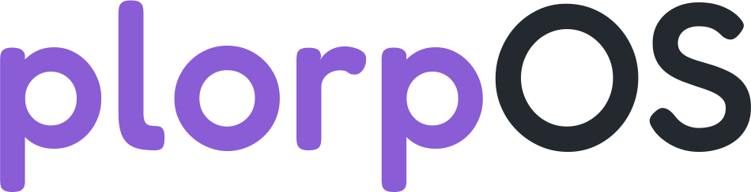
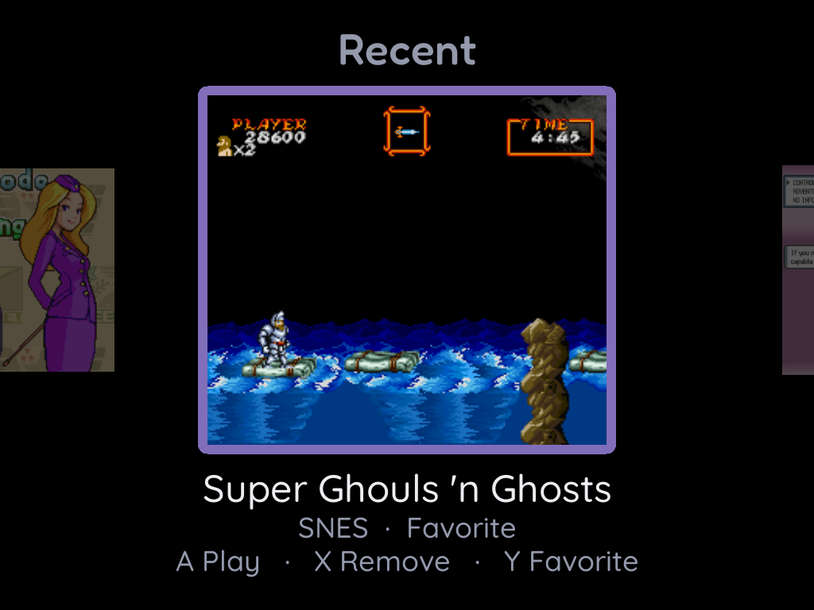
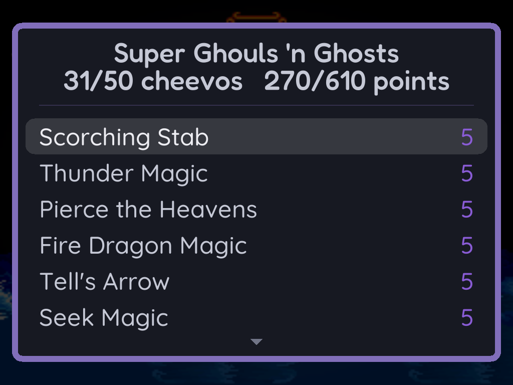
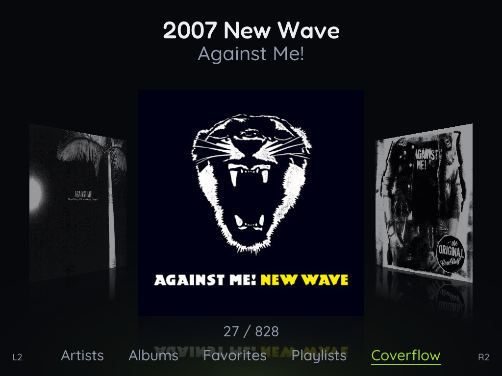
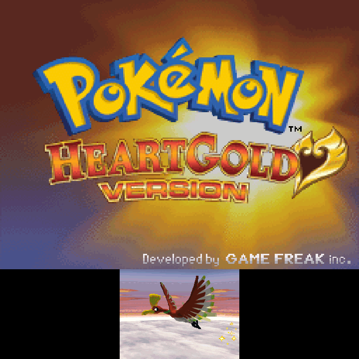
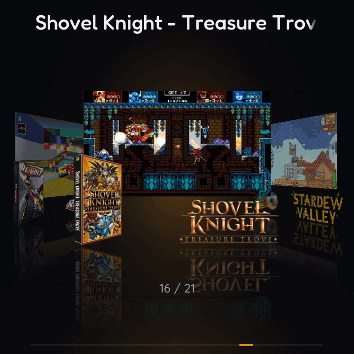

  <picture>
    <source media="(prefers-color-scheme: dark)" srcset="res/readme/logo-dark.png">
    
  </picture>

  <a href="#devices">Devices</a> &nbsp;·&nbsp;
  <a href="#supported-systems">Systems</a> &nbsp;·&nbsp;
  <a href="#install">Install</a> &nbsp;·&nbsp;
  <a href="#controls">Controls</a> &nbsp;·&nbsp;
  <a href="#faq">FAQ</a>

**plorpOS** is a Linux CFW for retro handhelds built around music, speed, and
features balanced against simplicity. It runs off an SD card: easy to install,
easy to remove.

It started as a fork of [TortOS](https://tortos.games/) for the TrimUI Brick and
has grown into its own project.

<table>
  <tr>
    <td align="center"> Main Shelf</td>
    <td align="center"> Game switcher</td>
    <td align="center"> RetroAchievements on the device</td>
  </tr>
  <tr>
    <td align="center"> Your albums, in Muse+</td>
    <td align="center"> Nintendo DS, laid out your way</td>
    <td align="center"> Ports, installed by PortMaster</td>
  </tr>
</table>

## Devices

| Handheld | How plorpOS runs | Guide |
|---|---|---|
| TrimUI Brick, Brick Hammer, Brick Pro | From the card, on modified stock (for faster boot). One card works in all three | [Brick](docs/install-brick.md) |
| Anbernic RG SP, RG34xxSP, RG35XX H, RG35XX SP | As the front end for [BaseOS](https://github.com/pvaibhav/BaseOS), on a second card | [H700](docs/install-h700.md) |
| Anbernic RG DS | A card image (trimmed ROCKNIX). The internal system is never touched | [RG DS](docs/install-rgds.md) |
| Anbernic RG Rotate | A card image ([base618](https://github.com/thwonp/base618), Linux). Android stays on the device | [RG Rotate](docs/install-rotate.md) |
| GKD 350H Ultra | On [BasedOS](https://github.com/thwonp/BasedOS), installed beside the stock ROCKNIX | [GKD](docs/install-gkd350based.md) |
| MagicX Zero 28 | A card image on [oakMOSS](https://github.com/spruceUI/oakMOSS) | [Zero 28](docs/install-zero28.md) |
| MagicX Zero 40 | A card image on [oakMOSS](https://github.com/spruceUI/oakMOSS) | [Zero 40](docs/install-zero40.md) |
| Miyoo Mini Flip | From the card, on stock firmware, with optional [fast boot firmware](https://github.com/thwonp/plorpOS/blob/main/docs/install-flip.md#faster-boot-optional) | [Mini Flip](docs/install-flip.md) |
| Anbernic RG Nano | **plorpOS nano**, a music-first version, as a card image | [RG Nano](docs/install-nano.md) |

Everything below is about the full plorpOS. The Nano's guide lists what nano
does.

## What it does

- **Muse+**: music, audiobooks and podcasts one or two buttons (or a swipe) away
  from anywhere, playing over your game. Local files, **Plex**, **Jellyfin**
  and **Audiobookshelf**, with downloads for offline play.
- **Games load fast**: the libretro emulator stays resident in memory.
- **Game switcher** for recent games from any screen.
- **Auto-save and resume**, **rewind**, **fast-forward**, **turbo**, hotkeys and
  per-game settings.
- **Sixteen shader presets** (not on the Mini Flip), Game Boy palettes, and Aspect, Stretch or Integer
  scaling (plus Integer Overscale on the square GKD and RG Rotate screens).
- **RetroAchievements**, signed in on the device. Sets download once and work
  offline; offline unlocks are sent later.
- **Nintendo DS** at full speed on every device but the Mini Flip, on
  **DSperate** v3.3.0 (GBA slot, Rumble Pak, Guitar Grip, analog patches), with
  **PokeDaisy DS** (Party, Dex, Map, Bag, Guide) per game. Layouts, scaling,
  stylus (touch where there is a screen for it) and microphone.
- **PortMaster** (unofficial) on every device but the Mini Flip. Report problems
  to plorpOS, not the PortMaster team.
- **Native PICO-8** with your own Raspberry Pi files in `Bios/`. Splore carts
  land on the shelf with their art.
- **Network**: Wi-Fi file transfer (Over The Hare), **Tailscale**, **Syncthing**
  for saves, and **updates over Wi-Fi**.
- **Bluetooth** headphones and **USB DACs**, with per-output volume limits.
- **Box art and metadata** scraped on the device, or imported from
  `gamelist.xml`.
- **Favorites, sorting, rename, delete** and **play time** for every game and
  console.

What each device has or lacks: its install guide. Every menu and setting:
[the guide](docs/guide.md).

## Supported systems

| Console | Put games in | File types | Core | BIOS |
|---|---|---|---|---|
| PICO-8 | `Roms/Pico-8` | `.p8` `.png` | fake-08, or native PICO-8 | `pico8.dat`, `pico8_64` (Mini Flip: `pico8_dyn`) |
| Arcade | `Roms/Arcade` | `.zip` `.7z` | FBNeo | Per game; non-merged ROMs recommended |
| Game Boy | `Roms/Game Boy` | `.gb` `.dmg` `.zip` | Gambatte, or PokeDaisy or mGBA (per game) | - |
| Game Boy Color | `Roms/Game Boy Color` | `.gbc` `.cgb` `.zip` | Gambatte, or PokeDaisy or mGBA (per game) | - |
| Game Boy Advance | `Roms/Game Boy Advance` | `.gba` `.agb` `.zip` | armGBA, or PokeDaisy over armGBA or mGBA (per game) | Optional: `gba_bios.bin` |
| Nintendo DS | `Roms/Nintendo DS` | `.nds` | DSperate-lr, or PokeDaisy DS (per game) | `bios7.bin`, `bios9.bin`, `firmware.bin` (encrypted ROMs only) |
| Super Nintendo | `Roms/SNES` | `.sfc` `.smc` `.zip` | Snes9x 2010 | - |
| NES | `Roms/NES` | `.nes` `.fds` `.unf` `.unif` `.zip` | FCEUmm | - |
| Sega Genesis | `Roms/Genesis` | `.md` `.gen` `.bin` `.smd` `.32x` `.zip` | PicoDrive | - |
| Sega 32X | `Roms/Genesis` or `Roms/32X` | `.32x` `.zip` | PicoDrive | - |
| Sega CD | `Roms/Genesis` or `Roms/Sega CD` | `.chd` `.cue` `.m3u` | PicoDrive | `bios_CD_U.bin`, `bios_CD_E.bin`, `bios_CD_J.bin` |
| Sega Master System | `Roms/Master System` | `.sms` `.zip` | PicoDrive | - |
| Sega Game Gear | `Roms/Game Gear` | `.gg` `.zip` | PicoDrive | - |
| TurboGrafx-16 and CD | `Roms/TurboGrafx-16` | `.pce` `.sgx` `.cue` `.ccd` `.chd` `.toc` `.m3u` `.zip` | Beetle PCE Fast | `syscard3.pce` for CD games |
| Neo Geo | `Roms/Neo Geo` | `.zip` `.7z` | FBNeo | `neogeo.zip` |
| Neo Geo Pocket | `Roms/Neo Geo Pocket` | `.ngp` `.ngc` `.ngpc` `.npc` `.zip` | Beetle NeoPop | - |
| Neo Geo Pocket Color | `Roms/Neo Geo Pocket Color` | `.ngp` `.ngc` `.ngpc` `.npc` `.zip` | Beetle NeoPop | - |
| PlayStation 1 | `Roms/PlayStation` | `.chd` `.cue` `.m3u` `.pbp` `.iso` `.img` | PCSX ReARMed | Optional: `scph5501.bin` (US) `scph5500.bin` (JP) `scph5502.bin` (EU) |
| Ports | `Roms/Ports` | installed by PortMaster | - | - |

- BIOS files go loose in `Bios/`.
- Sega CD and 32X games can share `Roms/Genesis` or get their own shelves.
- The Mini Flip uses lighter cores on some shelves: see
  [Shelves and cores](docs/install-flip.md#shelves-and-cores) and
  [Arcade and Neo Geo](docs/install-flip.md#arcade-and-neo-geo).

## Install

Follow your device's guide from the [Devices](#devices) table. In short:

1. Download your device's zip or card image from
   [Releases](https://github.com/thwonp/plorpOS/releases/latest).
2. **Zip** (Brick, H700, GKD, Mini Flip): unzip it onto a formatted card.
   **Image** (RG DS, RG Rotate, Zero 28, Zero 40, RG Nano): flash it to the card.
3. Put the card in and turn the device on. The first boot finishes the install.
4. Add games to `Roms/`, from a computer or over Wi-Fi.

Each guide has **Updating** and **Removing plorpOS** sections.

### Adding games over Wi-Fi

1. Join a network under **MENU > Wi-Fi**.
2. Open **MENU > Network Services > Over The Hare**. It shows an address and a
   PIN.
3. Open the address in a browser on the same network and type the PIN.
4. Drag games into their console's folder, albums into `Music`, books into
   `Audiobooks`. They're on the shelf when you leave the screen.

The PIN is new every time.

 

## Controls

| Button | On the shelf |
|---|---|
| **D-pad** | Move. The other direction jumps by letter or moves down a list |
| **A** | Open a console, start or continue a game |
| **B** | Back |
| **X** | The game's details |
| **Y** | Favorite |
| **L1/R1** | Jump a screenful |
| **MENU** | Settings for the device, or for the shelf you're in. Held: game switcher |
| **SELECT** | Muse+. Again to close |
| **POWER** | Tap to sleep, hold to turn off. Closing a lid sleeps too |

- **In a game:** MENU opens the in-game menu, held opens the game switcher.
  SELECT in that menu opens Muse+. POWER saves before sleeping or turning off.
- **Volume** buttons work everywhere. **Brightness** is MENU + volume (GKD:
  Home + volume; RG DS: per screen, see its guide).
- **Sticks:** the left stick is the d-pad; the right stick and stick clicks are
  free for hotkeys.
- **Touch screens** (RG DS, RG Rotate, Zero 40): tap to select, tap again to
  open. Swipe down from the top for Muse+, up from the bottom for the switcher.

**MENU > Controls** shows all of this on the device. Every button:
[the guide](docs/guide.md#controls).

## FAQ

<b>My games don't show up.</b>

- Check the folder name against [Supported systems](#supported-systems),
  spelled exactly, and the file type.
- A console with no games is hidden.
- Games copied while the device is on appear after **Rescan Folder** in that
  console's menu, or a restart. Over The Hare rescans for you.
- The log names every file a folder left out.

<b>A game has no box art.</b>

- **MENU > Game Settings > Scraping > Scrape Systems** fetches missing covers
  over Wi-Fi. MENU on a shelf has **Scrape Shelf** for that console alone.
- Sign in to a free [ScreenScraper](https://www.screenscraper.fr) account under
  **Scraping > ScreenScraper** for year, genre and synopsis too. Without one,
  covers come from [libretro's thumbnails](https://thumbnails.libretro.com).
- Your own: a PNG named like the game in `Roms/<console>/.media/`
  (`Black Castle.gb` wants `Black Castle.png`), about 512 px on the long side.
- Don't like a cover? X on the game > **Replace Box Art**.

More: [Box art](docs/guide.md#box-art).

<b>How do achievements work?</b>

- Sign in under **MENU > Game Settings > RetroAchievements >
  RetroAchievements Sign-In**.
- A game's first start needs Wi-Fi to download its set. After that it works
  offline; offline unlocks are sent later.
- **Download Achievement Sets** (same screen) fetches every game's set at once.
- **Achievements Enabled** off plays without them.

<b>How do hotkeys work?</b>

**Hotkeys** in the in-game menu: pick an action, press **A**, then its trigger,
alone or under a modifier. **X** clears. Each console keeps its own; none are
set for you. Actions: [the guide](docs/guide.md#hotkeys).

**Modifiers** (held for a chord like MENU + X; each hotkey has its own):

| Device | Modifiers |
|---|---|
| Brick, RG SP, RG35XX SP, RG Rotate, Zero 40, Mini Flip | Menu, Select |
| Brick Pro, RG34xxSP, RG35XX H, Zero 28 | Menu, Select, L Stick Click |
| GKD, RG DS | Menu, Home, Stick Click, Select |

**Triggers:**

- **L1, R1, L2, R2, A, B, X, Y:** with a modifier or alone. A button bound
  alone does the action instead of its job in that console's games.
- **Fn1, Fn2** (Brick, Brick Pro): with a modifier or alone.
- **D-pad and left stick:** with a modifier only.
- **Right stick** and its click (two-stick units): with a modifier or alone.
  Games never see it.
- **Nintendo DS:** no stick direction, since the stylus uses the stick.

A tap of MENU still opens the in-game menu, unless you pressed another button
while holding it. Holding MENU about 0.7 s opens the game switcher.

<b>How does turbo work?</b>

In a game, MENU > **Hotkeys > Turbo Assignments**: set a button to **Turbo
A** (or any other) and it fires that button about ten times a second while
held. **None** makes it normal again. Works at once; per shelf in **<Shelf>
Defaults > Hotkeys**.

A, B, X, Y, L1, R1, L2 and R2 can be turbo. More:
[Turbo](docs/guide.md#turbo).

<b>When does the device sleep, suspend or turn off?</b>

Under **MENU > System Settings**:

- **Auto Sleep** (default 1 min idle): as a POWER tap. Screen off, game paused,
  music plays on. **Suspend**, a much deeper rest, follows 10 s later.
- **Auto Off** (default Never; not on the RG Rotate): powers off when idle,
  resuming where you were. It and Auto Sleep exclude each other.
- Idle counts only on the shelf and in menus. With music playing, Muse+'s
  **Auto Screen Off** and **Paused Sleep Delay** decide.
- On a charger it never sleeps, suspends or turns off by itself. Muse+'s
  Auto Screen Off still goes dark on time.
- **Mini Flip:** no suspend or Auto Off; **Sleep Poweroff** (default 2 min)
  turns a sleeping Flip off.

<b>Can I use Bluetooth headphones?</b>

Yes, except on the Mini Flip and Zero 28 (on the Zero 40, headphones and speakers only). Pairing mode on the
headphones, then **MENU > Bluetooth**, **Y** to search, **A** to pair. They
reconnect by themselves. Wired headphones win when plugged in. More:
[Bluetooth](docs/guide.md#bluetooth).

**Brick and Brick Pro:** Wi-Fi starts first (they share one radio chip), so
headphones wait for Wi-Fi to connect or give up (15 s), and take 20 to 30 s
after sleep. Turn Wi-Fi off under **MENU > Wi-Fi** for a faster reconnect.

<b>How do I add music?</b>

`Music/<artist>/<album>/<tracks>`, e.g.
`Music/Radiohead/The Bends/01 Planet Telex.mp3`. MP3, M4A, M4B, AAC, FLAC, Ogg,
Opus and WAV. Loose songs move to `Music/Singles/`. Covers come from the files;
**MENU > Local Music Settings > Album Art** in Muse+ fetches better ones over
Wi-Fi.

Streaming from Plex, Jellyfin or Audiobookshelf: **MENU > Source** in Muse+.
See [Muse+](docs/guide.md#muse).

<b>How do I add audiobooks?</b>

One folder per book in `Audiobooks/`, with or without an author folder:
`Audiobooks/Iain M. Banks/The Hydrogen Sonata/`. One M4B or a folder of MP3s.
In Muse+, **MENU > Source > Local Audiobooks**. A book remembers your place,
power-off included.

<b>Where are my saves?</b>

- Battery saves: `Saves/<console>/<game>.srm` (folder named like `Roms/`).
  Saves from another device can go straight in. Written at most once a minute,
  and on the in-game menu, sleep or quit.
- Save states, autosave included: `.userdata/shared/.tortos/<console>/`.
- Updates leave them in place. **Syncthing** (MENU > Network Services) keeps
  `Saves/` in sync with your other devices.
- Neo Geo Pocket Color writes no `.srm`; its progress is in the autosave.

<b>Something went wrong. How do I send the logs?</b>

Open **MENU > Network Services > Over The Hare**, open its address in a
browser and click **Download logs** at the bottom of the first page. You get one `.tar.gz` with
the last ten boots' logs, network, headset and account names masked.

The logs are in `.userdata/<device>/logs/` on the card.

## AI Usage Disclosure

plorpOS was developed using AI-assisted workflows. Every commit was thoroughly
hand-tested along the way.

## For developers

plorpOS is C and SDL2, built on Eric Reinsmidt's TortOS. Games run in
[diatom](https://github.com/thwonp/diatom), plorpOS's fork of his small libretro
frontend, which starts once at boot and stays running.

- [How it works](docs/how-it-works.md): the resident emulator, boot, saves,
  achievements, ports
- [Settings](docs/how-it-works.md#settings): the two databases, `systems.cfg`
  and core options
- [Menus](docs/how-it-works.md#menus): how menus behave
- [Building](docs/building.md): toolchain, payloads, checks, deploying
- [Design decisions](docs/decisions/)

## Credits

plorpOS stands on a lot of other people's work. The licence of every piece is in [THIRD-PARTY-LICENSES.md](THIRD-PARTY-LICENSES.md) and [NOTICE](NOTICE), but here's some standouts:

- **[Eric Reinsmidt's](https://github.com/ericreinsmidt)** [TortOS](https://tortos.games/) and [diatom](https://github.com/ericreinsmidt/diatom) are the cornerstones this project forked from.
- **[NextUI](https://github.com/LoveRetro/NextUI)** provided sleep and suspend for the Brick, CHD reading, multiple shaders, and fast-forward/rewind/hotkeys design.
- **[beebono](https://github.com/beebono)** for [DSperate](https://github.com/beebono/DSperate) and their initial RG Rotate Linux port.
- **[crackerjacques](https://github.com/crackerjacques)** and **[TheGammaSqueeze](https://www.patreon.com/GammaOS/)** for more work [base618](https://github.com/thwonp/base618#credits) built on.
- **[pvaibhav](https://github.com/pvaibhav)** for [BaseOS](https://github.com/pvaibhav/BaseOS) which powers the h700 ports.
- **[theycallmeboxy](https://github.com/theycallmeboxy)** for [BasedOS](https://github.com/theycallmeboxy/BasedOS), the base of the GKD port.
- **[spruceUI](https://github.com/spruceUI)** for [oakMOSS](https://github.com/spruceUI/oakMOSS), the base of the MagicX ports.
- **[ROCKNIX](https://rocknix.org)**, which the RG DS image is built on.
- **[DrUm78](https://github.com/DrUm78)** for their [FunKey-OS](https://github.com/DrUm78/FunKey-OS/tree/fps-classics) build that plorpOS Nano built on.
- **[nelynes](https://github.com/nelynes)** of [slotPlus](https://github.com/nelynes/slotPlus) for helping with DSperate frame-skip implementation.
- **[tenlevels](https://github.com/tenlevels)** of [bloom](https://github.com/tenlevels/PakUI) for help on the Miyoo Mini Flip FBNeo build and fast boot firmware.
- **[Magnominus](https://github.com/MagnominusGit)** for [armGBA](https://github.com/MagnominusGit/armGBA).
- **[Plex](https://www.plex.tv)**, **[Jellyfin](https://jellyfin.org)** and **[Audiobookshelf](https://www.audiobookshelf.org)**, the media servers Muse+ streams from.
- All the contributors for [libretro](https://github.com/libretro), [PortMaster](https://portmaster.games), [RetroAchievements](https://retroachievements.org), [ScreenScraper](https://www.screenscraper.fr), and other projects used here.

## License

plorpOS is [MIT](LICENSE), like Eric Reinsmidt's TortOS and diatom it is built on, and so is its fork of diatom. The exception is code derived from NextUI - sleep and suspend here, fast-forward, rewind and hotkeys in diatom - which keeps NextUI's [PolyForm Noncommercial License 1.0.0](LICENSES/PolyForm-Noncommercial-1.0.0.txt); [NOTICE](NOTICE) lists exactly which files and regions. A card or release bundles that code, so as a whole it is not for commercial use. The cores keep their own licenses, two of them non-commercial. Full notices are in [THIRD-PARTY-LICENSES.md](THIRD-PARTY-LICENSES.md).
