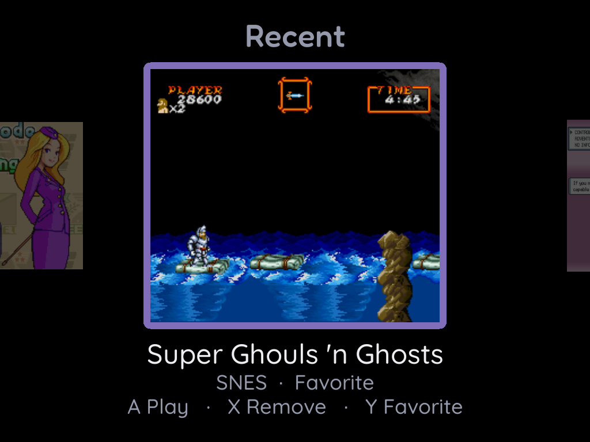
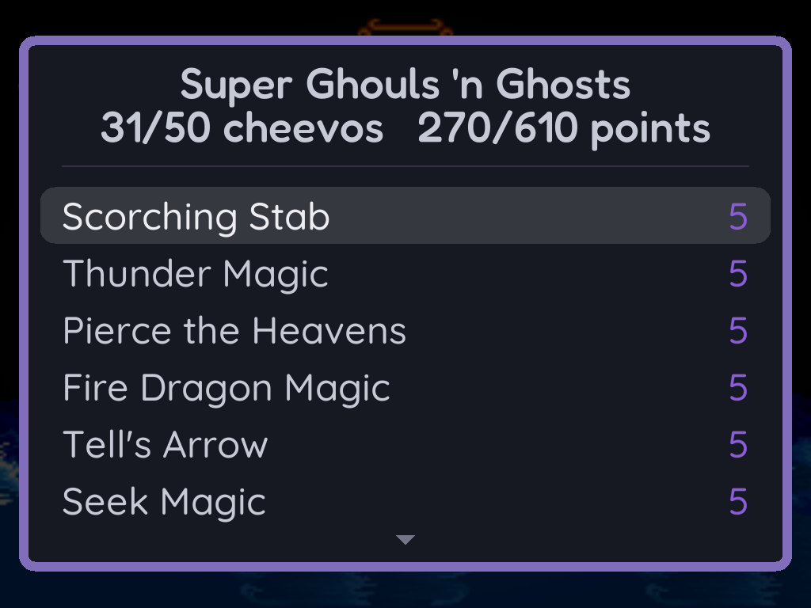
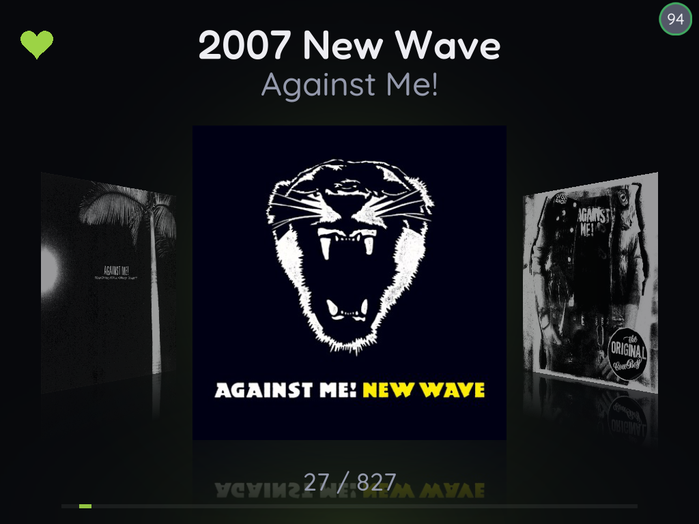
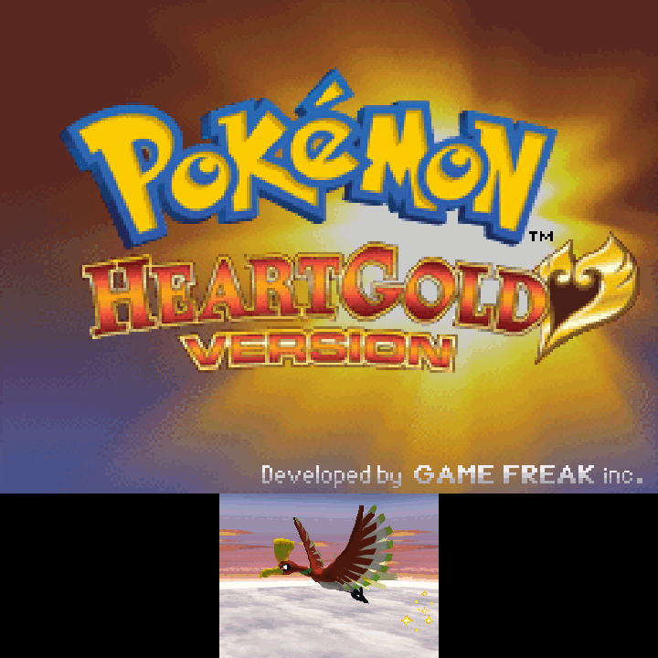
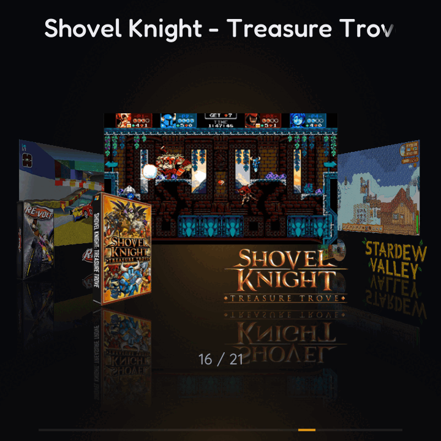

  <picture>
    <source media="(prefers-color-scheme: dark)" srcset="res/readme/logo-dark.png">
    
  </picture>

  <a href="#devices">Devices</a> &nbsp;·&nbsp;
  <a href="#supported-systems">Systems</a> &nbsp;·&nbsp;
  <a href="#install">Install</a> &nbsp;·&nbsp;
  <a href="#controls">Controls</a> &nbsp;·&nbsp;
  <a href="#faq">FAQ</a>

**plorpOS** is a Linux CFW for retro handhelds that prioritizes music, speed, and a balance of features to simplicity. It runs off an SD card, easy to install and remove if you're not feeling it.

plorpOS started as a fork of [TortOS](https://tortos.games/) for the TrimUI Brick but has since has grown into its own project, with many more handhelds supported and more added features to count.

<table>
  <tr>
    <td align="center"> Main Shelf</td>
    <td align="center"> Game switcher</td>
    <td align="center"> RetroAchievements on the device</td>
  </tr>
  <tr>
    <td align="center"> Your albums, in Muse</td>
    <td align="center"> Nintendo DS, laid out your way</td>
    <td align="center"> Ports, installed by PortMaster</td>
  </tr>
</table>

## Devices

| Handheld | How plorpOS runs | Guide |
|---|---|---|
| TrimUI Brick, Brick Hammer, Brick Pro | From the card, on the stock system. One card works in all three | [Installing on the Brick](docs/install-brick.md) |
| GKD 350H Ultra | On top of the stock ROCKNIX, at the screen's full resolution | [Installing on the GKD](docs/install-gkd.md) |
| Anbernic RG Rotate | A card image ([base618](https://github.com/thwonp/base618), Linux). Android stays on the device | [Installing on the RG Rotate](docs/install-rotate.md) |
| Anbernic RG SP, RG34xxSP, RG35XX H | As the front end for [BaseOS](https://github.com/pvaibhav/BaseOS), on a second card | [Installing on an H700](docs/install-h700.md) |
| Anbernic RG Nano | **plorpOS nano**, a pared down music-first version, as a card image | [Installing on the RG Nano](docs/install-nano.md) |

Everything below is about the full plorpOS. The Nano's guide lists what nano does.

## What it does

- **Music** and **audiobooks** are 1-2 buttons (or single swipe gesture) away from anywhere, even in the middle of a game, and **play over gameplay**.
- **Bluetooth** headphones and **USB DAC** support. 
- **Games load super fast** - libretro emulators live in resident memory.
- **Game switcher** to quickly access recent games from any screen. 
- **Auto-save and resume** (configurable), **Rewind**, **fast-forward**, **Turbo mode** and other features you should expect.
- **Fifteen shader presets**, Game Boy palettes, and Aspect, Stretch or Integer scaling.
- **RetroAchievements,** signed in on the device. A game's set downloads once and then works offline; unlocks made offline are sent later.

- **Nintendo DS** runs full speed **on every device** thanks to **DSperate** (runs under a libretro wrapper), with melonDS DS as an option on the RG Rotate and GKD.
    - Multiple Layout / Scaling options, Stylus emulation (and touch support), Microphone emulation.

- **Portmaster** (UNOFFICIALLY SUPPORTED) on every device. Most games seem to run great but this is experimental. Report problems to plorpOS, NOT the PortMaster team.
- **PICO-8 Native** works with Raspberry Pi files placed in `Bios/`. Carts you play in Splore land on the shelf with their artwork.

- **Scrape** box art / metatdata on-device, or import from gamelist.xml.
- **Favorites, sorting, Rename and Delete Game,** and **Play Time** for every game and console.

## Supported systems
| Console | Put games in | File types | Core |
|---|---|---|---|
| PICO-8 | `Roms/Pico-8` | `.p8` `.png` | fake-08, or native PICO-8 |
| Arcade | `Roms/Arcade` | `.zip` `.7z` | FBNeo |
| NES | `Roms/NES` | `.nes` `.fds` `.unf` `.unif` `.zip` | FCEUmm |
| Master System | `Roms/Master System` | `.sms` `.zip` | PicoDrive |
| Game Boy | `Roms/Game Boy` | `.gb` `.dmg` `.zip` | mGBA |
| Genesis, 32X and Sega CD | `Roms/Genesis` | `.md` `.gen` `.bin` `.smd` `.32x` `.zip` `.chd` `.cue` `.m3u` | PicoDrive |
| TurboGrafx-16 and CD | `Roms/TurboGrafx-16` | `.pce` `.sgx` `.cue` `.ccd` `.chd` `.toc` `.m3u` `.zip` | Beetle PCE Fast |
| Game Gear | `Roms/Game Gear` | `.gg` `.zip` | PicoDrive |
| Neo Geo | `Roms/Neo Geo` | `.zip` `.7z` | FBNeo |
| SNES | `Roms/SNES` | `.sfc` `.smc` `.zip` | Snes9x 2010 |
| Sega CD | `Roms/Sega CD` | `.chd` `.cue` `.m3u` | PicoDrive |
| Sega 32X | `Roms/32X` | `.32x` `.zip` | PicoDrive |
| PlayStation | `Roms/PlayStation` | `.chd` `.cue` `.m3u` `.pbp` `.iso` `.img` | PCSX ReARMed |
| Neo Geo Pocket | `Roms/Neo Geo Pocket` | `.ngp` `.ngc` `.ngpc` `.npc` `.zip` | Beetle NeoPop |
| Game Boy Color | `Roms/Game Boy Color` | `.gbc` `.cgb` `.zip` | mGBA |
| Neo Geo Pocket Color | `Roms/Neo Geo Pocket Color` | `.ngp` `.ngc` `.ngpc` `.npc` `.zip` | Beetle NeoPop |
| Game Boy Advance | `Roms/Game Boy Advance` | `.gba` `.agb` `.zip` | mGBA |
| Nintendo DS | `Roms/Nintendo DS` | `.nds` | DSperate-lr, or melonDS DS |
| Ports | `Roms/Ports` | installed by PortMaster | - |

Sega CD and 32X games can also go straight in `Roms/Genesis`, beside the
cartridges; use their own folders to give them their own cards.

**BIOS files** go loose in `Bios/`, never in a folder of their own.

- **Neo Geo** needs `neogeo.zip`.
- **TurboGrafx-CD** games need `syscard3.pce`.
- **Sega CD** games need `bios_CD_U.bin`, `bios_CD_E.bin` and `bios_CD_J.bin` (US, Europe, Japan); each disc uses its own region's.
- **PlayStation** runs without one; add `scph5500.bin`, `scph5501.bin` and `scph5502.bin` (Japan, US, Europe) for the best compatibility, and each disc uses its own region's.
- **Game Boy Advance** runs without its BIOS; add `gba_bios.bin` if you want the original boot animation.
- **Native PICO-8** needs `pico8_64` and `pico8.dat` from PICO-8's Raspberry Pi download. fake-08 needs nothing.
- **Nintendo DS** runs most games on the cores' own free BIOS; encrypted dumps need `bios7.bin`, `bios9.bin` and `firmware.bin`.

## Install

Each handheld sets up a little differently, so follow its guide from the [Devices](#devices) table. The short version:

1. Download the zip (or card image) for your device from [Releases](https://github.com/thwonp/plorpOS/releases/latest).
2. Put it on a microSD card as the guide says. On the Brick, GKD and H700 handhelds that means formatting the card exFAT and copying the zip's contents over; the RG Rotate and RG Nano get a flashed image.
3. Put the card in and turn the device on. The first boot finishes the install.
4. Add games to the folders in `Roms/`, from the computer now or over Wi-Fi later.

Taking the card out gives you the stock system back. Each guide has a **Removing plorpOS** section for anything the install left on the device.

### Adding games over Wi-Fi

1. Join a network under **MENU > Network Services > Wi-Fi**.
2. Open **MENU > Network Services > Over The Hare**. It shows an address and a PIN.
3. Open that address in a browser on your phone or computer, and type the PIN.
4. Drag games into their console's folder, albums into `Music` or books into `Audiobooks`. They're on the shelf when you leave the screen.

The PIN is new every time you open Over The Hare.

 

## Controls

| Button | On the shelf |
|---|---|
| **D-pad** | Move. On a shelf of games or albums, the other direction jumps by letter |
| **A** | Open a console, or start or continue a game |
| **B** | Back |
| **X** | The game's details |
| **Y** | Favorite |
| **L1/R1** | Jump a screenful |
| **MENU** | Settings for the device, or for the shelf you're in |
| **SELECT** | Muse, the music and audiobook player. Press it again to close |
| **POWER** | Tap to sleep, hold to turn off. Closing the RG SP's lid is a tap |

**In a game,** MENU opens the in-game menu and holding it opens the game switcher. SELECT in that menu opens Muse. A tap of POWER saves and sleeps; holding it saves and turns the device off.

The volume buttons work everywhere. Brightness is MENU plus volume (Home plus volume on the GKD). On devices with sticks, the left stick works as the D-pad, and the right stick and stick clicks can be hotkeys.

**MENU > Controls** on the device lists all of this, and [the guide](docs/guide.md) covers every button, menu and setting in detail.

## FAQ

<b>My games don't show up.</b>

Check the folder name against the table above, spelled exactly, and that the file type is listed for that console. A console with nothing in its folder is hidden. Games sent over Over The Hare appear when you leave its screen. Games copied any other way while the device is on appear after **Rescan Folder** in that console's menu, or after a restart. The log names every file a console's folder left out, and the file types it takes.

<b>A game has no box art.</b>

**MENU > Game Settings > Scraping > Box Art** fetches every missing cover over Wi-Fi. Sign in to a free [ScreenScraper](https://www.screenscraper.fr) account under **MENU > Game Settings > Scraping > ScreenScraper** and it asks there first, and brings each game's year, genre and synopsis for its details screen. Without an account, or for a game ScreenScraper doesn't have, it uses [libretro's thumbnail collection](https://thumbnails.libretro.com), looking a game up by its file name and, for zipped games, by checksum.

Some games aren't in either collection, like fan translations and homebrew. Add your own: a PNG named exactly like the game file, in `Roms/<console>/.media/`. `Black Castle.gb` wants `Black Castle.png`. Around 512 pixels on the long side is plenty.

Don't like a cover? Press X on the game and choose **Replace Box Art**. It looks again, and if nothing turns up, you keep the one you had.

<b>How do achievements work?</b>

Sign in to your RetroAchievements account under **MENU > Game Settings > Achievements Sign-In**. The first time you start a game, the device needs Wi-Fi to look it up and download its achievements. After that the game works offline, and anything you unlock offline is kept and sent to your account later. To get every game's achievements in one go before you leave Wi-Fi, use **Download Achievement Sets** on the same screen; it counts the games with no achievements to earn (hacks, translations, dumps RetroAchievements never listed, and many arcade sets). To play without them, turn off **Achievements Enabled** on the same screen.

<b>How do hotkeys work?</b>

Open **Hotkeys** in the in-game menu. There are six actions: **Fast-Forward** and **Rewind** (both work while held), **Quick Save**, **Quick Load**, **Screenshot** and **Turbo Assign** (see the next question). A Nintendo DS game adds **Screen Layout ->** (the next screen layout; MENU + X by default on the GKD and Rotate) and **Blow Into Mic** (held: the game hears you blow into the microphone). On the GKD it also adds **Stylus Tap**, the button that touches where the stick's cursor is (R2 by default). On the Brick, Brick Pro and H700 handhelds it adds **Screen Layout <-** (the previous layout), **Stylus Tap** (R Stick Click by default on a unit with two sticks) and, on a unit without a second stick, **Stylus Mode** (a cursor over the bottom screen, moved by the D-pad). With two sticks the cursor is always on, moved by the stick the in-game menu's **Stylus Stick** row picks, right by default. Pick an action, press **A**, then press its trigger: a button alone, or held under a modifier. **X** clears an action, and a lone tap of **MENU** cancels while it waits. Each console keeps its own bindings, and none are set until you set them. **Rewind Speed** and **Fast-Forward Speed** are in **MENU > Game Settings**.

**Modifiers** are buttons you hold for a chord, like MENU + X. Each hotkey has its own: hold the modifier when you press the trigger and the screen shows it, so Fast-Forward on L Stick Click + A and Rewind on MENU + A work side by side. The modifiers each device offers:
- **Brick, RG SP:** Menu or Select.
- **Brick Pro, RG34xxSP, RG35XX H:** Menu, Select or L Stick Click.
- **GKD:** Menu, Home, Stick Click or Select.

A tap of MENU still opens the in-game menu when you let go, unless you pressed another button while holding it. Holding MENU on its own for about 0.7 s opens the game switcher.

**Triggers:**
- **L1, R1, L2, R2, A, B, X, Y:** with a modifier held, or alone. A button bound alone does the action instead of its job in that console's games.
- **D-pad and left stick directions:** with a modifier held only, so moving always works.
- **The right stick** (Brick Pro, RG34xxSP, RG35XX H): its four directions and its click, with a modifier held or alone. Games never see it, so binding it alone costs nothing.
- **Nintendo DS:** no stick direction is a trigger, since the stylus uses the stick.

One button can hold several actions: one alone and one under each modifier. On a unit with two sticks the left stick's triggers read "L Stick". Bindings saved before each hotkey had its own modifier keep the one that was set then.

<b>How does turbo work?</b>

Bind **Turbo Assign** under **Hotkeys** in the in-game menu, like any other hotkey. Then, in a game:

- **Press Turbo Assign, then a button.** That button is turbo now: hold it and it presses itself about ten times a second. The press that picks it isn't sent to the game.
- **Do the same again** to make that button normal again. Several buttons can be turbo at once.
- **Press Turbo Assign twice** to change your mind before picking a button.
- **Hold Turbo Assign for 2 seconds** to make every button normal again.

A short notice says what happened each time. A, B, X, Y, L1, R1, L2 and R2 can be turbo; the d-pad, START and SELECT can't. Turbo lasts until you quit the game: the in-game menu and Muse don't touch it, and the next game starts with none. To keep it, turn on **Persistent Turbo Assignments** in **MENU > Game Settings**: each game then starts with the turbo buttons you last gave it. A button the console doesn't use, like X on the NES, does nothing as turbo either.

<b>What do Auto Sleep and Auto Off do, and when does the device suspend?</b>

They're under **MENU > System Settings**. The device has two ways to rest: **sleep** turns the screen off and pauses a game (music keeps playing), and a tap of POWER brings you straight back. **Suspend** is a much deeper rest that barely touches the battery.

- **Auto Sleep** (default 1 minute): how long the device sits untouched before it sleeps, exactly as if you'd tapped POWER.
- **Suspend** comes 10 seconds after the device falls asleep, however it fell asleep. When music ends with the screen dark, it suspends 30 seconds later. Neither is a setting.
- **Auto Off** (default Never; not on the RG Rotate): how long the device sits untouched before it powers itself off. Next time you turn it on, you're back where you were. Auto Off and Auto Sleep can't both be on: setting one turns the other to Never.

Auto Sleep and Auto Off only count time on the shelf and in the menus, the in-game menu included, never while you're playing. While music plays, Muse's own **Screen Off** setting decides when the screen goes dark instead. Plugged in to charge, the device never sleeps, suspends or powers off on its own.

<b>Can I use Bluetooth headphones?</b>

Yes. Put them in pairing mode, open **MENU > Bluetooth**, press **Y** to search and **A** to pair. They reconnect by themselves from then on. Wired headphones always win when they're plugged in.

The device's volume buttons set the headphones' volume, and the headphones' own volume buttons move the device's. On a few headphones, the device's buttons set only the starting volume; after that, change it on the headphones themselves. Play, pause and skip on the headphones control Muse.

**On the Brick and Brick Pro, Wi-Fi starts before Bluetooth,** at power-on and after sleep. The two share one radio chip, and on the Brick Pro starting them together could freeze the device. So the headphones wait until Wi-Fi has connected, or has given up after 15 seconds, and take around 20 to 30 seconds to come back after sleep. Turn Wi-Fi off under **MENU > Network Services** when you don't need it, and they reconnect sooner.

<b>How do I add music?</b>

Put it in `Music/` on the card, from a computer or over Wi-Fi with Over The Hare, a folder per artist and a folder inside that per album: `Music/Radiohead/The Bends/01 Planet Telex.mp3`. An album folder put straight into `Music/` is moved under its artist when its tags name one, and songs in no folder at all are moved into `Music/Singles/`, an album of their own. MP3, M4A, M4B, AAC, FLAC, Ogg, Opus and WAV all play. Muse appears on the shelf once there's music, and each album's cover comes from its own files, or a picture in the album's folder. **MENU > Album Art** on Muse's shelf fetches a sharper cover over Wi-Fi from [MusicBrainz](https://musicbrainz.org)'s Cover Art Archive for any album whose files carry none, or only a small one.

<b>How do I add audiobooks?</b>

Put each book in its own folder in `Audiobooks/`, with an author's folder above it or without: `Audiobooks/Iain M. Banks/The Hydrogen Sonata/` or `Audiobooks/The Hydrogen Sonata/`. One M4B or a folder of MP3s both work, and the files play in name order. **MENU > Show** on Muse's shelf switches between your music and your books. A book remembers where you stopped, even through a power-off, and one played to the end is marked finished; A on it starts it over.

<b>Where are my saves?</b>

Battery saves are `.srm` files in `Saves/<console>/`, named after the game; the console folder is named like its `Roms/` folder, and the release comes with one for every console, so saves from another device can go straight in. A game's battery save is written at most once a minute while you play, and always when you open the in-game menu, sleep or quit. If you upgraded a Brick from plorpOS v1.1 or TortOS, move the old saves loose in `Saves/` into those folders - see [Upgrading a TortOS card](docs/install-brick.md#upgrading-a-tortos-card). Save states, the autosave included, are in `.userdata/shared/.tortos/`, one folder per console. Neo Geo Pocket Color games write no `.srm`, so their progress lives in the autosave.

<b>Something went wrong. How do I send the logs?</b>

Open **MENU > Network Services > Over The Hare**, open its address in a browser, and click **Download logs** at the bottom of the first page. You get one `.tar.gz` file holding the last ten boots' logs and a short summary of the device, ready to send to whoever is helping you. Wi-Fi network, headset and account names are masked in it, and the logs on the card are left as they are. The logs themselves are in `.userdata/tg3040/logs/` (Brick), `.userdata/gkd/logs/` (GKD) or `.userdata/rgsp/logs/` (RG SP) on the card.

## AI Usage Disclosure

plorpOS was developed using AI assisted workflows. Every commit was thoroughly hand-tested along the way.  

## For developers

plorpOS is C and SDL2, built on Eric Reinsmidt's TortOS. Games run in [diatom](https://github.com/thwonp/diatom), plorpOS's fork of his small libretro frontend, which starts once at boot and stays running.

- [How it works](docs/how-it-works.md): the resident emulator, the boot, and card art off the render thread
- [Configuration](docs/configuration.md): the two settings databases, `systems.cfg` and core options
- [Building](docs/building.md): the toolchain, the card, the checks, and deploying to a device
- [Design decisions](docs/decisions/) and [how menus behave](docs/menus.md)

## Credits

- **DS frame skipping.** When a heavy 3D scene would run late, the frontend tells DSperate and the core leaves that frame's rendering out, so the game keeps its speed. The approach, and the idea of driving it from libretro's audio-buffer-status callback, is from nelynes's [slotPlus](https://github.com/nelynes/slotPlus) (`crates/slot-retro`), which does the same for DSperate on the RG SP. Our version is `mk/patches/dsperate-lr-frameskip.patch` and Diatom's frame loop.

## License

plorpOS is [MIT](LICENSE), like Eric Reinsmidt's TortOS and diatom it is built on, and so is its fork of diatom. The exception is code derived from NextUI - sleep and suspend here, fast-forward, rewind and hotkeys in diatom - which keeps NextUI's [PolyForm Noncommercial License 1.0.0](LICENSES/PolyForm-Noncommercial-1.0.0.txt); [NOTICE](NOTICE) lists exactly which files and regions. A card or release bundles that code, so as a whole it is not for commercial use. The cores keep their own licenses, two of them non-commercial. Full notices are in [THIRD-PARTY-LICENSES.md](THIRD-PARTY-LICENSES.md).
